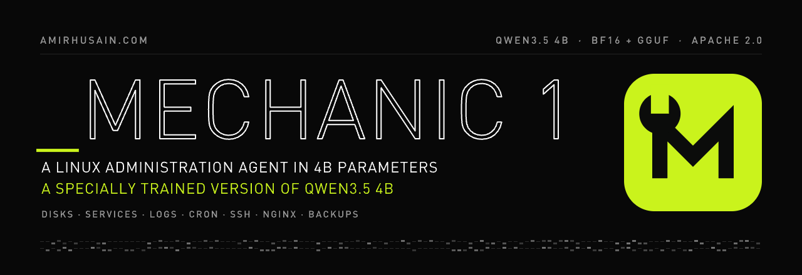

<p align="center"><a href="https://amirhusain.com/mechanic">amirhusain.com/mechanic</a></p>

# mechanic

`mechanic` is a command-line agent for Linux administration. It sends your task to a language model and shows each
command that the model proposes. You approve, edit or reject each command before it runs.

It works with [AH-Mechanic-1-4B](https://huggingface.co/ahtx/AH-Mechanic-1-4B), and with any server that has an
OpenAI-compatible `/v1/chat/completions` API: Kindi, vLLM, the llama.cpp server and others. It uses the system prompt
and the `bash` tool that AH-Mechanic-1-4B was trained with.

```text
$ mechanic "nginx -t fails on this machine. Find the syntax error in /etc/nginx/nginx.conf and fix it."

[1] $ nginx -t 2>&1
  Run it? [y]es / [e]dit / [n]o / [q]uit: y
  exit code 1
  [emerg] unexpected "}" in /etc/nginx/nginx.conf:10
...
[3] $ sed -i '8s/worker_connections 768$/worker_connections 768;/' /etc/nginx/nginx.conf
  edit in place (sed): /etc/nginx/nginx.conf
    affects: /etc/nginx/nginx.conf (1445 bytes)
  Run it? [y]es / [e]dit / [n]o / [q]uit:
```

## Install

Python 3.9 or later. There are no required dependencies.

```bash
pip install git+https://github.com/ahtx/mechanic
mechanic --version
```

## Get a model server

mechanic needs an OpenAI-compatible endpoint. With [AH-Mechanic-1-4B](https://huggingface.co/ahtx/AH-Mechanic-1-4B)
and a recent llama.cpp build:

```bash
huggingface-cli download ahtx/AH-Mechanic-1-4B AH-Mechanic-1-4B-Q8_0.gguf --local-dir .
llama-server -m AH-Mechanic-1-4B-Q8_0.gguf --jinja -ngl 99 -c 32768 --port 8090   --chat-template-kwargs '{"enable_thinking": false}'
mechanic config endpoint http://localhost:8090/v1
```

## Run a task

```bash
mechanic --endpoint http://localhost:8000/v1 "Find what fills /var and tell me before you delete anything."
mechanic config endpoint http://localhost:8000/v1     # save the endpoint once
mechanic config model AH-Mechanic-1-4B               # if the server needs a model name
```

For each proposed command, you can:

- **y**: run it.
- **e**: edit it, then run your version. The model is told what you changed.
- **n**: reject it. You can give a reason; the model gets the reason and tries another way.
- **q**: end the session.

After the model's answer, you can type a follow-up request in the same session.

Set `MECHANIC_API_KEY` if your server needs a key. mechanic turns thinking off in the chat template
(`enable_thinking: false`), as in training.

### Safety guard

Before you decide, mechanic shows what a command can change, and what that means on this machine now:

- deletes (`rm`, `find -delete`, `find -exec rm`, `shred`, `unlink`): the files that match, and file counts in
  directories. For `find`, mechanic runs the same search without the delete action to list the matches.
- overwrites (`>`, `cp`, `mv`, `tee`, `dd of=`, `truncate`, `sed -i`, `ln -sf`): the files that exist now.
- processes and services (`kill`, `pkill`, `killall`, `systemctl stop/disable/mask/restart`): the process command
  line behind each PID, the processes that a pattern matches, and the current state of each unit.
- recursive `chmod`/`chown`, disks and partitions, crontab removal, account removal, firewall flushes, package
  removal, container removal, and reboot or shutdown.

A target that you did not name in your request is marked **NOT NAMED IN YOUR REQUEST**. A target counts as named when
you wrote its path, a directory that contains it, its file name, a glob that matches it (such as `*.log`), or its
process or service name.

The guard only reads the system. It is a help for your review, not a sandbox.

### Flag checker

Small models sometimes write options that do not exist. Before a command runs, mechanic checks each option against
the program's local documentation (`man`, and `--help` for programs where that is safe). If an option is not in the
documentation, the command does not run. The model gets the program's NAME line and its first 40 option lines, and
tries again:

```text
`--sort-by-size` is not an option of `ls`. Its options:
ls - list directory contents
       -a, --all
       ...
The command was not run.
```

You can choose to run the command anyway.

The checker stops a command only when the program has documentation with at least three options, and the option
does not appear anywhere in it. Programs without documentation are not checked. For programs with subcommands (git,
systemctl, ip, apt, docker and others), it also reads the subcommand's page. The command after `find -exec` is not
checked as find options. Turn the checker off with `--no-flag-check` or `mechanic config flag_check off`.

### `--auto`

`--auto` runs every command without asking, so it refuses to run unless mechanic is inside a container or a virtual
machine. It checks `/.dockerenv`, `/run/.containerenv`, `systemd-detect-virt` and the container markers in
`/proc/1/cgroup`. WSL does not count as isolated. On a host it exits with a message. To accept the risk, add
`--allow-auto-on-host`: mechanic prints a warning, you type `yes`, and the session log records `"auto_override": true`.
The guard and the flag checker still run, and the log records what they found.

## Daily checkup (recommendation mode)

`mechanic checkup` is a read-only health check. It collects the state of the machine one section at a time, sends
each section to the model, and prints what it collected, then "Mechanic recommends:" with numbered findings. Each
finding says what the model sees, why it matters, an exact command that a person could run, and the risk of that
command. The summary at the end is built by mechanic from every finding, most risky first; nothing is left out.

```bash
mechanic checkup                        # print to the terminal and save a Markdown report
mechanic checkup --report               # quiet: print only the summary and the report path (for timers)
mechanic checkup --webhook URL          # also POST the summary and the report path as JSON
mechanic schedule --daily 07:00         # run `mechanic checkup --report` every day as your user
mechanic schedule --remove
```

| Section | What it collects |
|---|---|
| Logs | the journal at priority warning or worse, login and authentication messages, and warning-like lines in syslog/messages, auth.log/secure, kern.log and the nginx/Apache error logs, for the last 24 hours. Repeated lines are merged with a count. |
| Disk | `df -h`, `df -i`, and the largest directories under /var, /var/log, /home and /tmp (`du` with a time limit) |
| Processes | load, top CPU and memory users, zombie processes, failed systemd units |
| Memory | `free -m`, swap, OOM kills in the last 24 hours |
| Network | listening ports, listeners on uncommon ports that are reachable from outside, established connections grouped by remote address |

**Read-only.** The collectors run only a fixed list of read-only programs (`journalctl`, `df`, `du`, `ps`,
`systemctl --failed`, `free`, `swapon --show`, `ss`, `uptime`, `nproc`, and `man -P cat` to read documentation) as
argument lists, never through a shell. Options that change state (such as `journalctl --vacuum-*` or `ss -K`) are
refused. The model's suggestions are text: checkup never runs them. You decide what to run.

**Rules over the model's answer.** mechanic applies fixed rules to every finding:
- Each suggested command is checked against its local man page. An option that does not exist, or a non-numeric
  value for a numeric option (such as `sshd -p /var/log/auth.log`), hides the command as "unverified". A command
  whose options cannot be checked is marked.
- A risk is never lower than the rule for its command. Firewall changes, `kill`, `systemctl stop/restart`, package
  changes and in-place edits are at least medium; anything that can cut network access or delete data is high. A
  missing risk becomes the rule's level, or medium.
- Findings about the same unit, process ID, port, IP address or path are merged.

**Secrets.** Keys, tokens, passwords on command lines and private keys are masked before any data goes to the model
and before the report is saved. IP addresses, user names and host names stay, because the findings need them. Reports
are saved in `~/.local/state/mechanic/reports/YYYY-MM-DD-HHMM.md`, readable only by you. The model endpoint defaults
to a local llama-server (`http://localhost:8000/v1`, or what `mechanic config endpoint` says).

**Schedule.** `mechanic schedule --daily HH:MM` installs a user systemd timer (`~/.config/systemd/user/
mechanic-checkup.timer`) when your user manager runs, and otherwise one line in your crontab. It installs nothing
system-wide and never uses sudo. Run `loginctl enable-linger $USER` if the timer must run while you are logged out.
To see everything, run the checkup as a user who can read the journal (for example, a member of `adm` or
`systemd-journal`) or as root.

## Session logs (off by default)

Logging is off until you turn it on:

```bash
mechanic --log "..."          # this session only
mechanic config log on        # every session
mechanic logs                 # list; --show ID; --delete ID; --delete-all
```

Each session is one JSONL file in `~/.local/share/mechanic/sessions/`, readable only by you. It holds the request,
each proposed command, your decision (approved, edited with the new text, or rejected with your reason), the flag
check and guard findings, the command output (cut to 4,000 characters by default), the final answer, and your rating:
solved or not solved. The logs stay on your machine. mechanic sends nothing except the chat requests to the endpoint
that you set.

## `mechanic contribute`

You can share your logged sessions to help improve the model. Nothing leaves your machine until you confirm it.

```bash
mechanic contribute           # review, then upload to the community dataset (after one more confirmation)
mechanic contribute --file    # review, then only write a file (to attach to a GitHub issue)
```

1. **Redact.** mechanic replaces secrets and identifying details with placeholders: private keys, API keys and tokens
   (cloud, code hosting, chat, payment and model-hub formats, JWTs), passwords in assignments, URLs, headers and
   options, password hashes, long random strings, e-mail addresses, IP and MAC addresses, host names, private domain
   names, user names and home paths. The same value gets the same placeholder in one session (`<IP_1>`, `<USER_2>`).
   Add your own patterns with `mechanic config redact_patterns 'REGEX'`, or during review.
2. **Review.** mechanic shows the exact redacted payload of each session. You accept it, drop it, or add a pattern
   and look again.
3. **Consent.** You dedicate the logs to the public domain under
   [CC0 1.0](https://creativecommons.org/publicdomain/zero/1.0/), confirm that you have the right to share them and
   that you reviewed the redacted payload, and type "I agree". You can give a name to credit on the model page
   (optional); every valid contributor is acknowledged there. The first line of the bundle records `consent: true`,
   `licence: "CC0-1.0"`, the name and `mechanic_version`.
4. **Send.** mechanic writes one bundle file in `~/.local/share/mechanic/outbox/`. By default it asks once more,
   then uploads the file. With `--file`, it only prints the file path.

The redaction is a pattern scanner. It reduces risk; it does not remove it. Read each payload before you accept it.

## Tests

```bash
python3 -m unittest discover -s tests -t .
```

The tests cover redaction with real-looking secrets, the flag checker, the guard, the confirm flow (approve, edit,
reject, quit), end-to-end dry runs of `run` and `contribute` against a local fake endpoint, and `checkup`: the
collectors on fixture outputs, secret masking, the allow list, and a run in which the model suggests `rm -rf` while
every way to start a process is patched to fail (nothing runs). The session tests run
real commands in a temporary folder, so they need Linux and bash.

`tests/e2e_real_model.sh` is a manual end-to-end run with a real model server, inside a throwaway container (it
breaks nginx and creates old logs on purpose). `docs/real-model-run-2026-11-22.log` is its output with
AH-Mechanic-1-4B: both tasks were solved in four commands each.

## License

Apache License 2.0. See `LICENSE`.

Project page: [amirhusain.com/mechanic](https://amirhusain.com/mechanic). Model: [AH-Mechanic-1-4B](https://huggingface.co/ahtx/AH-Mechanic-1-4B).
